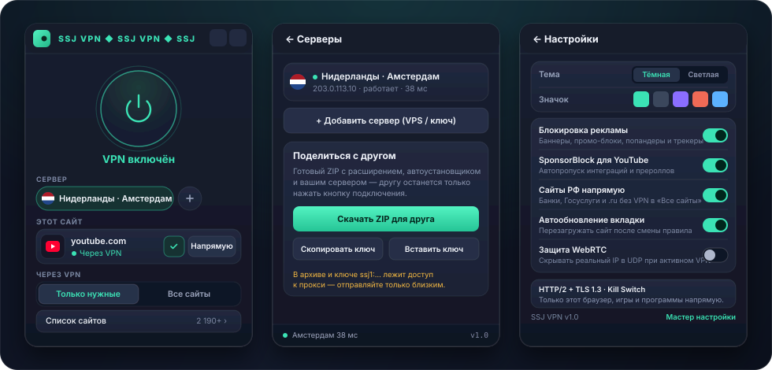
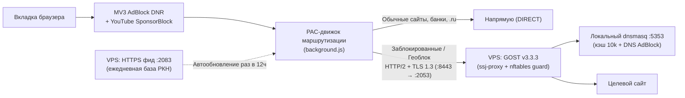

<div align="center">


# SSJ VPN

**Личное браузерное расширение с раздельной маршрутизацией, автоустановкой на свой VPS, встроенным AdBlock и SponsorBlock.**

[](https://github.com/purrfect0/SSJExtension/releases)
[](#поддерживаемые-браузеры)
[](#2-серверный-стек-serverinstallsh)
[](#структура-проекта)
[](LICENSE)

<br>



</div>

---

## Зачем нужен SSJ VPN

**SSJ VPN** работает только внутри браузера, не трогает системные сетевые адаптеры, не роняет скорость и пинг в играх и не требует ручной возни с конфигами на сервере:

- **Умная маршрутизация (Split Tunneling):** заблокированные и геоблокируемые ресурсы (YouTube, Discord, ChatGPT, Claude, Gemini, NotebookLM, Spotify, Instagram, X, Notion, Figma и ещё 2 100+ доменов и 17 300+ диапазонов IPv4 РКН) идут через ваш VPS, а остальные сайты, банки и Госуслуги открываются напрямую на полной скорости провайдера.
- **Развёртывание сервера в 1 команду:** укажите IP любого VPS на Debian / Ubuntu прямо в окне расширения — оно само сгенерирует команду для SSH, дождётся выпуска TLS-сертификата и автоматически подключится к серверу. Соседние сервисы на VPS (Docker, Xray, WireGuard / Amnezia, веб-сайты) не затрагиваются.
- **Передача близким без настроек:** кнопка **«Скачать ZIP для друга»** прямо в браузере собирает готовый архив с автоустановщиком и уже встроенным сервером — получателю остаётся только нажать кнопку включения. Для мгновенного обновления сервера по сообщению есть компактные ключи `ssj1:…`.
- **Гибридный AdBlock + YouTube без рекламы:** блокировка рекламы и трекеров одновременно в браузере (`declarativeNetRequest` + аккуратный косметический фильтр с отключением в 1 клик на любом сайте) и на DNS-уровне сервера (`dnsmasq`), плюс встроенный **SponsorBlock** и безопасный автопропуск видеорекламы YouTube.
- **Совместимость с Zapret:** если на компьютере уже запущен локальный `Zapret`, один переключатель оставляет YouTube и Discord на прямом канале, пуская через VPN только геоблоки (AI-сервисы, зарубежные платформы и сайты с проверкой IP).

---

## Поддерживаемые браузеры

Любой настольный браузер на базе **Chromium (Manifest V3)**:
Google Chrome, Microsoft Edge, Brave, Яндекс Браузер, Opera, Vivaldi, Arc, Thorium, Helium.

---

## Быстрый старт

### 1. Установка расширения

#### Автоматически на Windows (за 30 секунд)
1. Скачайте архив `SSJ_VPN_v1.0.zip` в разделе [**Releases**](https://github.com/purrfect0/SSJExtension/releases) и распакуйте его.
2. Запустите **`Установить_SSJ_VPN.cmd`** — скрипт скопирует расширение в постоянную папку `%LOCALAPPDATA%\SSJ_VPN` (чтобы очистка папки «Загрузки» ничего не сломала), поместит путь в буфер обмена и откроет памятку.
3. Откройте `chrome://extensions/` (или `edge://extensions/` / `browser://extensions/`), включите **«Режим разработчика»**, нажмите **«Загрузить распакованное расширение»**, вставьте путь (`Ctrl + V`) и подтвердите выбор.

#### Вручную (Windows / macOS / Linux)
1. Склонируйте репозиторий или распакуйте папку расширения в постоянное место:
   ```bash
   git clone https://github.com/purrfect0/SSJExtension.git
   ```
2. Откройте `chrome://extensions/` → включите **«Режим разработчика»** → нажмите **«Загрузить распакованное расширение»** и выберите папку проекта (где лежит `manifest.json`).

---

### 2. Подключение своего сервера (VPS)

В публичной сборке на GitHub **нет преднастроенных серверов**. Подключить свой можно тремя способами (кнопка **`+`** на главном экране или раздел **«Серверы» → «Добавить сервер»**):

1. **Автоматически на VPS (рекомендуется):**
   - Арендуйте любой зарубежный VPS на **Debian 11/12** или **Ubuntu 22.04/24.04+** с публичным IPv4 (достаточно 1 vCPU и 512 МБ–1 ГБ RAM).
   - Введите IP-адрес сервера на вкладке **«На VPS»** и нажмите **«Получить команду»**.
   - Вставьте скопированную команду в SSH-консоль сервера под `root`. Через ~30–60 секунд расширение само обнаружит поднятый TLS-прокси, определит страну с флагом и включит защиту.
2. **По ключу доступа (`ssj1:…`):** если вам прислали готовый ключ сервера — вставьте его на вкладке **«По ключу»** или кнопкой **«Вставить ключ»** в разделе «Серверы».
3. **Вручную:** укажите IP, порт, логин и пароль любого совместимого HTTPS/HTTP2-прокси с валидным TLS-сертификатом.

---

### 3. Как поделиться с друзьями и близкими

Когда у вас добавлен хотя бы один сервер, откройте **«Серверы» → «Поделиться с другом»**:
- **«Скачать ZIP для друга»** — локально в браузере (без внешних серверов) собирает и скачивает готовый архив `SSJ_VPN_for_friend.zip` с автоустановщиком `Установить_SSJ_VPN.cmd`, инструкцией и уже вшитым профилем вашего сервера. Другу не нужно вводить ни IP, ни пароли — при первом открытии он просто жмёт кнопку включения.
- **«Скопировать ключ»** — копирует компактную строку `ssj1:…` для быстрой отправки нового сервера или обновлённого пароля тем, у кого расширение уже установлено.

> **Важно:** готовый архив для друга и строка `ssj1:…` содержат логин и пароль вашего прокси-сервера. Пересылайте их только близким людям и не публикуйте в открытом доступе.

---

## Как всё работает под капотом



### 1. Клиентский PAC-движок раздельной маршрутизации (`background.js`)
Маршрутизация работает через нативный `chrome.proxy.settings` со скомпилированным только в ASCII `pac_script` и строгим режимом `mandatory: true`. Порядок проверки каждого запроса в режиме **«Только нужные»**:

1. **Служебные и локальные адреса** (`localhost`, частные подсети RFC 1918/CGNAT и сам IP прокси-сервера) всегда идут `DIRECT`, исключая петли маршрутизации.
2. **Пользовательские исключения («Напрямую»)** — домены, поддомены и подсети из вкладки «Напрямую» всегда обходят VPN (даже в режиме «Все сайты»).
3. **Пользовательский список («Мой список»)** — любые добавленные вручную сайты или IP принудительно идут через прокси.
4. **Профиль Zapret** (опционально) — если выбран режим «Zapret на компьютере: Есть», домены и голосовые/медиа-подсети YouTube и Discord идут `DIRECT` через локальный DPI-обходчик.
5. **База доменов РКН и геоблоков** (`O(1)` поиск по хэш-таблице суффиксов домена) — встроенная база плюс свежие домены, автоматически подгружаемые с вашего VPS.
6. **Быстрый пропуск известных доменов РФ** (`.ru`, `.рф`, банки, маркетплейсы, Госуслуги — если конкретный домен не числится в базе блокировок) без лишних вызовов `dnsResolve()`.
7. **Бинарный поиск по IPv4-диапазонам РКН и защита от DNS-заглушек** — более `17 300` объединённых диапазонов хранятся в дельта-сжатом виде (`~370 КБ`) и проверяются за `O(log N)`. Если провайдер отдаёт DNS-заглушку (`127.0.0.1` / `0.0.0.0`) или заблокированный IP — запрос автоматически уходит в туннель.

**Отказоустойчивость и Kill Switch:** PAC возвращает цепочку `HTTPS <ip>.sslip.io:8443; HTTPS <ip>.sslip.io:2053` без `DIRECT` в конце. Если провайдер режет порт `:8443`, Chromium прозрачно переключается на резервный `:2053`, а при полном обрыве связи заблокированные сайты не «светят» прямое соединение провайдеру.

### 2. Серверный стек (`server/install.sh`)
Установочный скрипт идемпотентен, проверяет занятость портов до внесения изменений (умеет безопасно приостанавливать веб-сервер или Docker-контейнер на порту `80` ровно на несколько секунд выпуска сертификата) и разворачивает 4 изолированных компонента:

- **`ssj-proxy.service` (GOST v3.3.3):** мультиплексированный прокси `HTTP/2 over TLS 1.3` на портах `:8443` и `:2053` с сертификатом **Let's Encrypt** (`<IP>.sslip.io` с автооткатом на `<IP>.nip.io` и хуком автопродления). Сотни запросов браузера летят внутри одного постоянного TLS-соединения с включённым **TCP BBR**.
- **Двухуровневая защита от SSRF и DNS-rebinding:** сервис работает от бесправного системного пользователя `ssjproxy` (`NoNewPrivileges=yes`, `ProtectSystem=strict`), при этом и конфиг GOST (`bypass`), и отдельная таблица ядра Linux **`nftables` (`inet ssj_guard` по `meta skuid "ssjproxy"`)** жёстко блокируют любые исходящие обращения прокси к `127.0.0.0/8`, `10.0.0.0/8`, `172.16.0.0/12`, `192.168.0.0/16` и `169.254.0.0/16` (метаданные облаков и соседние локальные панели на VPS недоступны даже через поддельный DNS).
- **`ssj-dns.service` (`dnsmasq` на `127.0.0.1:5353`):** локальный DNS-кэш на `10 000` записей с отсечением рекламных и трекинговых доменов (AdGuard DNS + Peter Lowe) и еженедельным автообновлением через `ssj-adblock.timer`.
- **`ssj-feed.service` (`:2083`):** легковесный многопоточный HTTPS-сервер с защитой от Slowloris-таймаутов, отдающий сжатый `gzip`-слепок актуальных доменов блокировок (`/v1/ssj-rules.json`, ~12 КБ), который пересобирается раз в сутки таймером `ssj-rkn-feed.timer`.

Для полного и чистого удаления прокси в настройках сервера расширения есть кнопка копирования команды `server/uninstall.sh`.

### 3. Гибридный AdBlock и YouTube-модуль
- **Сетевой фильтр (`data/adblock_rules.json`):** скомпилированный набор правил Manifest V3 `declarativeNetRequest` на базе *AdGuard Russian Filter*, *AdGuard Base*, *AdGuard DNS* и *Peter Lowe* с защитой от поломки банков, капч и авторизаций.
- **Тумблер для конкретного сайта:** кнопка щита на карточке «Этот сайт» добавляет домен в динамические правила `allowAllRequests` (приоритет `100`) и мгновенно отключает как сетевую, так и косметическую фильтрацию на выбранном ресурсе.
- **YouTube (`content/youtube.js`):** пропускает спонсорские интеграции, саморекламу и напоминания через публичный API **SponsorBlock** с сохранением приватности (отправляется только 4-символьный префикс `SHA-256` хэша `videoId`, k-anonymity, с кнопкой «Вернуть» в плеере) и мягко перематывает рекламные вставки без модификации скриптов плеера.

### 4. Мастер первой настройки и сохранение состояния
При первом открытии расширение предлагает за 15 секунд выбрать удобный режим («Настроить под себя» или «Разберусь сам»). Все настройки хранятся в `chrome.storage.local`, поэтому при обновлении расширения заменой файлов в папке проходить настройку заново или заново добавлять серверы не нужно.

---

## Структура проекта

```text
SSJExtension/
├── manifest.json            # Конфигурация Chromium Manifest V3
├── background.js            # PAC-маршрутизатор, прокси-авторизация, health-check, SponsorBlock, синхронизация
├── content/
│   ├── cosmetic.js          # Лёгкое скрытие рекламных слотов и промо-блоков
│   └── youtube.js           # SponsorBlock + безопасный автопропуск видеорекламы YouTube
├── popup/
│   ├── popup.html / .css    # Интерфейс окна расширения (тёмная и светлая темы, 5 цветовых схем значка)
│   ├── distribution.js      # Генератор готового ZIP-архива для друзей прямо в браузере (CRC32 + ZIP writer)
│   └── views/               # Модули экранов: главный, серверы, добавление VPS, правила, настройки, онбординг
├── data/
│   ├── default_rules.js     # Скомпилированная база доменов и дельта-диапазонов IPv4 РКН
│   ├── adblock_rules.json   # Статический набор правил MV3 declarativeNetRequest
│   ├── bundled_profile.js   # Пустой профиль в релизе (заполняется автоматически при сборке ZIP для друга)
│   ├── routing_utils.js     # Нормализация доменов/IP/CIDR и бинарный поиск по диапазонам
│   └── rule_policy.json     # Источники списков и политика исключений для пересборки базы
├── server/
│   ├── install.sh           # Автоустановщик GOST HTTP/2 + Let's Encrypt + dnsmasq + nftables + RKN feed
│   └── uninstall.sh         # Чистое удаление всех служб SSJ VPN с VPS
├── installer/
│   ├── install_windows.cmd  # Автокопирование в %LOCALAPPDATA%\SSJ_VPN и подготовка буфера обмена
│   └── guide.html           # Интерактивная локальная памятка по установке
└── scripts/
    ├── build_rules.js       # Пересборка базы РКН и геоблоков (Node.js 20+, без зависимостей)
    ├── build_adblock.js     # Пересборка правил AdBlock MV3 DNR (Node.js 20+, без зависимостей)
    └── package_extension.py # Сборка релизного архива и индекса data/package_files.json (Python 3)
```

---

## Пересборка списков и архива

В проекте **0 внешних npm/pip-зависимостей** — используются только стандартные модули Node.js 20+ и Python 3:

```bash
# Обновить встроенную базу доменов, геоблоков и IPv4-диапазонов РКН
node scripts/build_rules.js

# Обновить статический набор правил блокировки рекламы MV3 DNR
node scripts/build_adblock.js

# Собрать чистый релизный архив SSJ_VPN_v1.0.zip
python scripts/package_extension.py
```

---

## Лицензия

Распространяется под лицензией [MIT](LICENSE). Иконки интерфейса основаны на наборе [Lucide](icons/ui/LICENSE-LUCIDE.txt) (ISC / MIT).
